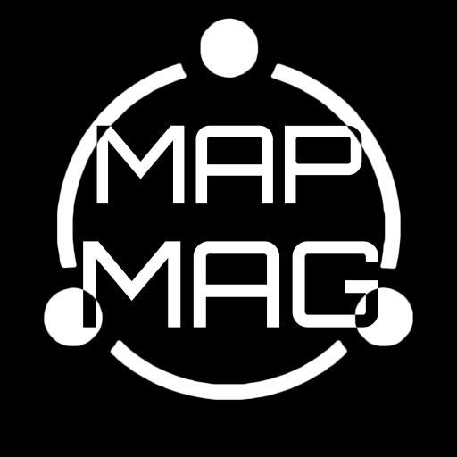

<div align="center">
  
  <h1>BZ_MAP_MAG</h1>
  <p><strong>2D / 3D Map & Terrain Editor for Battlezone: Combat Commander</strong></p>
  <p>Sculpt terrain. Build missions. Export native maps. Playtest.</p>

  
  
  
  

  <p><a href="#quick-start">Quick start</a> · <a href="#workspace">Workspace</a> · <a href="#compatibility">Compatibility</a> · <a href="docs/PROJECT_DETAILS.md">Technical guide</a></p>
</div>

## Overview

A standalone map editor for Battlezone: Combat Commander with synchronized 2D and 3D views, a docked creative workspace and native map import/export. Edit maps using the installed game and mod assets, then validate and playtest the result.

## Workspace

| Module | Purpose |
|---|---|
| **Terrain Sculpting** | Heightfield brushes, slope tools, shape operations, vertex color and tile painting. |
| **Mission & Paths** | Path creation, point editing, mission references and scene navigation. |
| **Object Browser** | Mod-scoped ODF and asset discovery, placement and transform editing. |
| **Water & Environment** | Native water layers and verified sky/fog editing, with approximate previews identified separately. |
| **Node Studio** | Procedural height/slope masks, color blending, tile selection and layer baking. |
| **New Map & Profiles** | Stock-first terrain creation, configurable engine/mod/mission profiles and compatibility analysis. |
| **Export & Playtest** | Validated native export, launch preflight and supported in-game testing. |

The docked interface brings scene, layers, assets, viewport and attributes into one workspace, with undo/redo, persistent layouts and recoverable autosaves.

## Quick start

From the repository root, run `BZ_MAP_MAG.cmd` (or the built `BZ_MAP_MAG.exe` when available).

To open the source project with Godot 4.7.2:

```powershell
& "path/to/Godot_v4.7.2-stable_win64.exe" --path app
```

Configure the installed BZCC path and the optional VRV converter in **Settings**. Open a supported native map or create a new Stock-first map.

## Compatibility

| Target | Current intent / boundary |
|---|---|
| **Stock BZCC** | Compatibility baseline: 2.0.185; supported native 1192 maps can launch without VRV. |
| **VSR / VRV / Workshop** | Mod profiles and dependency analysis; support depends on the specific map and assets. |
| **1196 maps** | Supported verified routes require the configured VRV converter. |
| **Native export** | Re-import validation; structural, engine-load and gameplay verification are distinct. |

**v0.0.1 — early development.** Unsupported object classes and unknown native layouts remain restricted or preview-only. See the [compatibility matrix](docs/COMPATIBILITY_MATRIX.md) and [engine limitations](docs/ENGINE_LIMITATIONS.md) before assuming a map or feature is fully supported.

## Documentation

| Guide | Contents |
|---|---|
| [Technical guide](docs/PROJECT_DETAILS.md) | Detailed controls, launch routes and build/test commands. |
| [Architecture](docs/ARCHITECTURE.md) | Editor and project snapshot rules. |
| [Format research](docs/FORMAT_RESEARCH.md) | Native formats and dependencies. |
| [Editor parity](docs/EDITOR_PARITY.md) | Editor capability coverage. |
| [Compatibility matrix](docs/COMPATIBILITY_MATRIX.md) | Verified and restricted workflows. |
| [Evidence](docs/EVIDENCE.md) · [Reference inventory](docs/REFERENCE_INVENTORY.md) | Reproduction, measurements and references. |

See [CHANGELOG.md](CHANGELOG.md) for changes. Original game meshes and textures remain in the local game or mod installation.

## Battlezone toolkit

[ODF laboratory — BZ_ODF_SHAMAN](https://github.com/vacterro/BZ_ODF_SHAMAN) · [Model converter — bzconv](https://github.com/vacterro/BZ_XSI_MSH_FBX_CONVERTER) · [Project index](https://github.com/vacterro)

<div align="center"><sub>Native maps. Creative control. Verified export.</sub></div>
