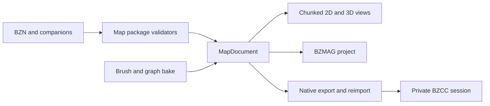

# Architecture

The first release candidate uses the standard Godot x64 runtime in Compatibility mode. GDScript handles the first heightfield codec in-process. The editor package runs without a .NET installation. A separate C++ oracle and a .NET BZN probe keep format research outside the UI and use the local reference implementations.

- `formats/` reads TER v5, records BZN wire version via the capability layout registry (`bzn_layouts.gd`), reads and patches bounded native path and object tables (including 13 verified class-specific native new-class builders and mission DLL patching in `bzn_objects.gd`), decodes/patches WAT v5, decodes binary `.SKY` containers with strict `sky-v1-7068` surgical `1YKS` write admission (`sky_env.gd`), and indexes TRN / INF. The source files and their hashes are retained. Unverified chunks and other member data remain opaque/read-only.
- `core/` owns the canonical heightfield, sparse committed terrain, water, environment (`1YKS`), path, object and mission-DLL edits, shared history, layer settings, temporary previews, `ModRegistry` (recursive Workshop dependency graph), `AssetIndex` (loose + `DOCP` v2 `.pak` + DLL SHA-256), `MissionProfiles`, and the single authoritative `CompatibilityEngine` (`bzmag.compatibility-result/1`). New height values use the map's granularity and a conservative ±32,000 step limit.
- `render/` samples that document. The 2D view uploads only changed image tiles. The 3D view holds 64-sample chunks with adaptive native-2 m near / 4 m mid / 8 m distant LOD, boundary seam snapping, deferred per-frame LOD convergence capped by actual chunk rebuild count, and an opt-in Approximate Editor Preview for `.SKY` fog and lighting. The brush picker samples the underlying 2 m grid.
- `nodes/` validates acyclic links for height, noise delta, RGB, tile IDs, slope and masks. Each enabled layer reads the previous layers' height, RGB and base tile results. The Slope input measures the committed height snapshot in degrees using neighboring samples. The worker reads a bounded material snapshot and uses a generation and document revision to reject superseded results. Preview isolates display state and Bake validates and commits the active outputs in one undo entry. BZMAG retains old height links and settings alongside the new optional outputs.
- `bridge/` stages a new project file or output directory on the destination volume. Native export verifies each file and reimports the result before publishing via rename. Object stream edits resize the BZN before the 640-byte `groupTargets` mission boundary, shift the cached path offsets, patch the native object count and optional mission DLL, and re-verify every field of every record; `.SKY` edits surgically rewrite only verified `1YKS` float slots on admitted `sky-v1-7068` layouts while keeping all other chunks byte-identical. Source files are checked for revision drift before and after staging. Export requires a new destination and blocks unbaked previews. Project save uses a new path and checks ordinary collisions.
- `ui/` implements the unified Cinema 4D / Photoshop-style docked DCC workspace shell (`workspace_state.gd`, `attributes_inspector.gd`, `collapsible_section.gd`, `scene_tree.gd`, `layers_panel.gd`, `tools_panel.gd`, `object_attributes_panel.gd`): a single-row MenuBar + frequent actions + 6 workspace presets (`Default`, `Sculpting`, `Mission`, `Object Placement`, `Nodes`, `Fullscreen Viewport`) + command filter; resizable 3-column `HSplitContainer` docking (`Left Dock`: `Scene`/`Layers`/`Assets`/`Tools`; `Center Workspace`: `3D+2D`/`3D`/`2D`/`Nodes`/`New Map`/`Settings`; `Right Dock`: pinnable `AttributesInspector`); and a compact status bar with a collapsible diagnostics drawer. All 11 editing tools (`SlopeStudioPanel`, `TerrainCommands`, `WaterCommands`, `EnvironmentStudio`, `SoundEditor`, `PathInspector`, `MissionStudio`, `ObjectBrowser`, `NodeStudio`, `NewMapWizard`, `TargetProfileDialog`, plus embedded `Settings`) mount directly as docked `Control`s with zero modal editing popups obstructing the viewport, persisting `[workspace]` layout state in `user://editor.cfg` with viewport clamping and Reset Layout.
- `themes/` provides four Wintage themes (`goldendefault`, `vintagedark`, `vintageclassic`, `nord`), embedded crisp 1-bit `Verdana_m1` bitmap strikes without antialiasing (`app/themes/fonts/`), Houdini-style MMB Value Ladder `SliderField` controls, `ChoiceGroup` toggle buttons, Wintage `Tree`/`MenuButton`/`TabBar`/`TabContainer` styling, and viewport-clamped compact `Wintage.popup_fit` dialog sizing for OS file pickers and rare confirmation alerts.

The dependency resolver recognizes same-stem map companions and explicit local INF preview/description files. It preserves the map stem because the BZN and INF can refer to it. Editor Playtest prepares the native snapshot directly under a short temporary directory and configures an isolated game process with read references to installed stock and optional VSR assets. The native snapshot and cloned runtime are removed on exit. The engine may log session diagnostics in its shared Documents log directory.

## Implemented roadmap

1. Extend BZN path verification to more save layouts. Binary 1197 path verification and whole-path editing in the verified table layout are implemented. Additional layouts and mission-specific runtime behavior require their own evidence.
2. The Windows editor exposes the verified flat-template operation in **New Map**. The supplied blank's size and no-script Playtest profile have evidence. Running custom mission scripts requires a separate map-specific check.
3. Playtest uses a linked, ordered asset profile per project and checks direct mission DLL and Lua dependencies for recognized BZN references before launch. Dynamic Lua imports and internal DLL dependencies still require a map-specific run.
4. Native RGB and packed tile painting preserve unedited TER channels. The WAT preview decodes layered occupancy and elevation from representative v5 fixtures. Water editing patches coverage bits and layer-height floats in place through the same reimport-verified export; water simulation fields stay opaque.
5. Slope-plane and four directional heightfield mirrors are document commands. The graph supports height, RGB and base tile outputs through typed connections, isolated previews and one undoable bake.
