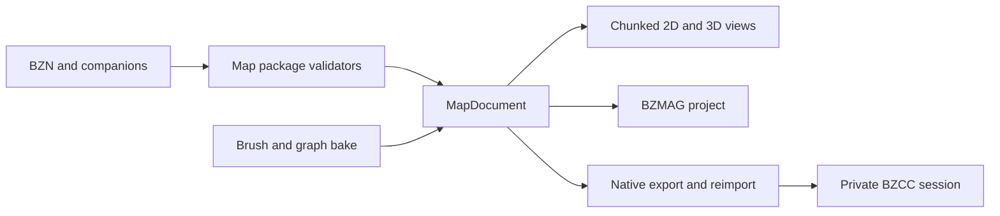

# Architecture

The first release candidate uses the standard Godot x64 runtime in Compatibility mode. GDScript handles the first heightfield codec in-process. The editor package runs without a .NET installation. A separate C++ oracle and a .NET BZN probe keep format research outside the UI and use the local reference implementations.

- `formats/` reads TER v5, records BZN wire version, reads and patches a bounded native path table, and indexes TRN / INF. The object stream reader keeps each record's matrix and byte span, so position, orientation, duplication count and removal all edit the same binary spawn list. The source files and their hashes are retained. Other member data remains opaque.
- `core/` owns the canonical heightfield, sparse committed terrain and path edits, shared history, layer settings, and temporary previews. New height values from the height brush, slope plane and node evaluator use the map's granularity and a conservative ±32,000 step limit. Object edits are view-ordered over the kept base stream plus the user's additions; transforms persist as exact native floats and every added record keeps a fresh unused sequence and a copied or renamed label.
- `render/` samples that document. The 2D view uploads only changed image tiles. The 3D view holds 64-sample chunks with 8 m display tessellation and rebuilds only affected chunks and their normal dependencies. The brush picker samples the underlying 2 m grid. These levels of detail can differ where fine features lie between render vertices.
- `nodes/` validates acyclic links for height, noise delta, RGB, tile IDs, slope and masks. Each enabled layer reads the previous layers' height, RGB and base tile results. The Slope input measures the committed height snapshot in degrees using neighboring samples. The worker reads a bounded material snapshot and uses a generation and document revision to reject superseded results. Preview isolates display state and Bake validates and commits the active outputs in one undo entry. BZMAG retains old height links and settings alongside the new optional outputs.
- `bridge/` stages a new project file or output directory on the destination volume. Native export verifies each file and reimports the result before publishing via rename. Object stream edits resize the BZN before the path table, shift the cached path offsets, patch the native object count and re-verify every field of every record. Source files are checked for revision drift before and after staging. Export requires a new destination and blocks unbaked previews. Project save uses a new path and checks ordinary collisions.
- `themes/` adapts Golden Default design tokens to Godot Theme resources. App controls and child windows use the Windows Verdana files when installed. The application pack contains no system font files.

The dependency resolver recognizes same-stem map companions and explicit local INF preview/description files. It preserves the map stem because the BZN and INF can refer to it. Editor Playtest prepares the native snapshot directly under a short temporary directory and configures an isolated game process with read references to installed stock and optional VSR assets. The native snapshot and cloned runtime are removed on exit. The engine may log session diagnostics in its shared Documents log directory.

## Implemented roadmap

1. Extend BZN path verification to more save layouts. Binary 1197 path verification and whole-path editing in the verified table layout are implemented. Additional layouts and mission-specific runtime behavior require their own evidence.
2. The Windows editor exposes the verified flat-template operation in **New Map**. The supplied blank's size and no-script Playtest profile have evidence. Running custom mission scripts requires a separate map-specific check.
3. Playtest uses a linked, ordered asset profile per project and checks direct mission DLL and Lua dependencies for recognized BZN references before launch. Dynamic Lua imports and internal DLL dependencies still require a map-specific run.
4. Native RGB and packed tile painting preserve unedited TER channels. The WAT preview decodes layered occupancy and elevation from representative v5 fixtures. Water simulation fields stay opaque.
5. Slope-plane and four directional heightfield mirrors are document commands. The graph supports height, RGB and base tile outputs through typed connections, isolated previews and one undoable bake.
